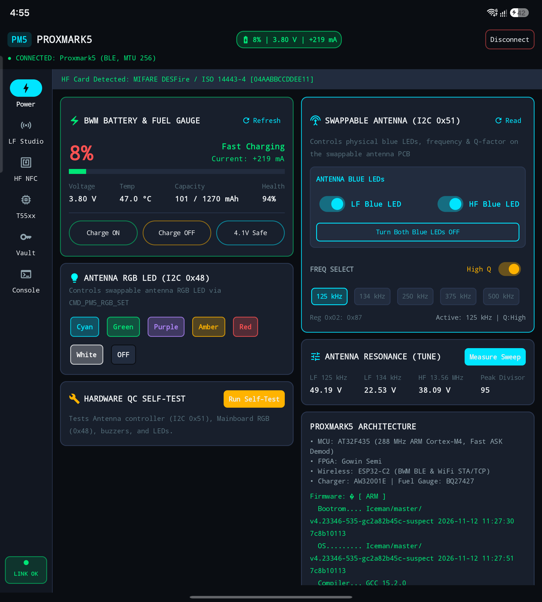
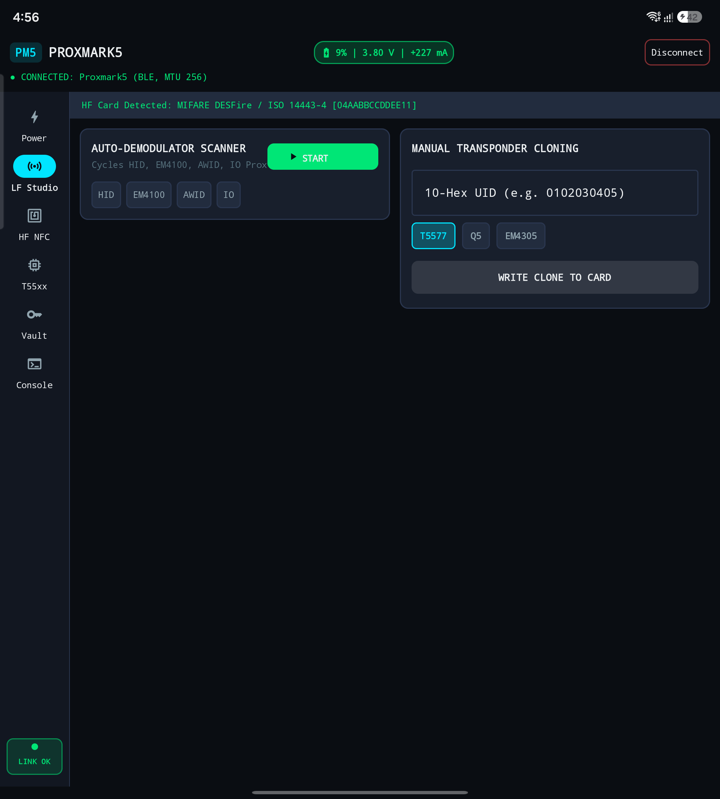
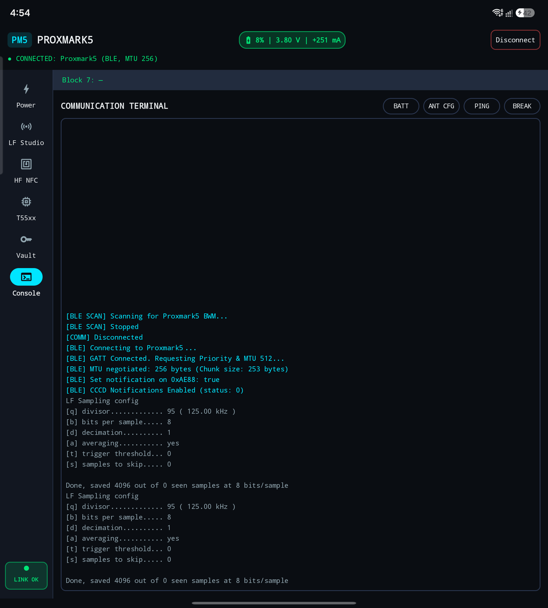
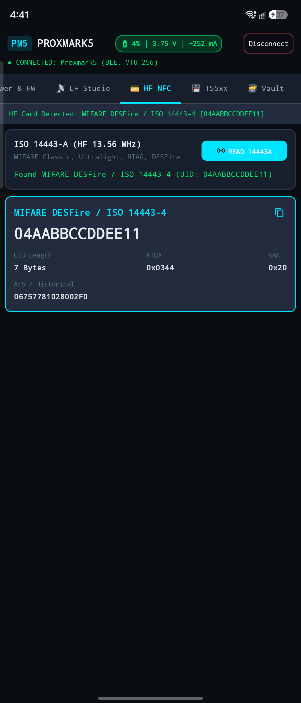
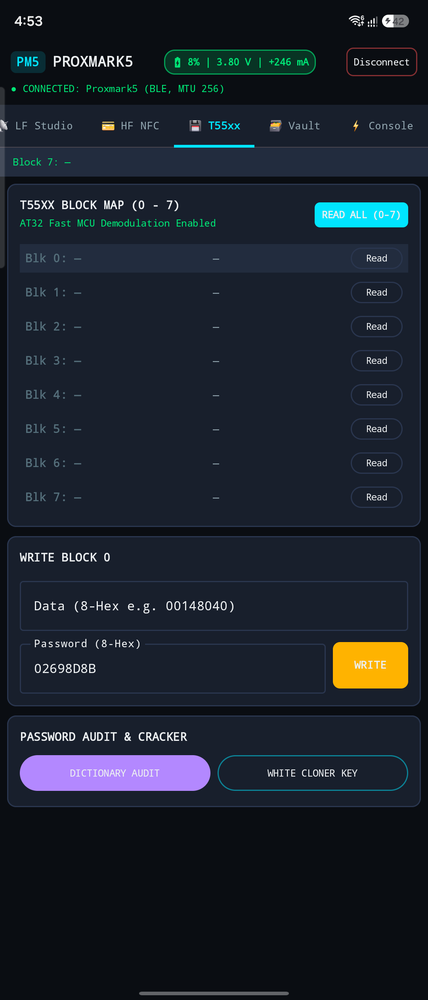

# Proxmark5 Android Client

Native Android companion client for the **Proxmark5** (`AT32F435` 288 MHz ARM Cortex-M4 + Gowin FPGA) equipped with the **Battery / Wireless Module (BWM, ESP32-C2)**.

Built in Kotlin and Jetpack Compose, the client communicates directly over **Bluetooth Low Energy (GATT)** and **WiFi (TCP)** using the Proxmark3 `PM3a` / `PM3b` Next-Gen (`NG`) binary framing protocol (`CRC-16/X-25`). It provides direct control over the Proxmark5's power subsystem, swappable smart antenna (`I2C 0x51`), RGB controller (`I2C 0x48`), LF badge demodulators, T55xx transponder programmer, and ISO 14443-A reader, with an adaptive layout supporting both standard handsets and unfolded foldable displays.

---

## Interface Gallery

### Unfolded / Tablet Layout (`NavigationRail` + 2-Column Workspace)

| Power & Hardware Telemetry | HF NFC Studio (ISO 14443-A) |
| :---: | :---: |
|  |  |
| **LF Badge Studio & Cloner** | **Credential Vault & JSON Exporter** |
|  |  |

<p align="center">
  
</p>

### Folded Cover / Compact Phone Layout

| HF ISO 14443-A Reader | T55xx Block Map & Password Audit |
| :---: | :---: |
|  |  |

---

## System Architecture

```
┌─────────────────────────────────────────┐                ┌──────────────────────────────────────────┐
│      Android Host (Jetpack Compose)     │                │         Proxmark5 Hardware Engine        │
│                                         │                │                                          │
│  • Adaptive UI (Cover Tabs / NavRail)   │   BLE GATT     │  • ESP32-C2 BWM (BLE 0xAE86 / TCP:18888) │
│  • PM3a / PM3b NG Frame Parser (X-25)   │ ◄────────────► │  • AT32F435 MCU (288 MHz ARM Cortex-M4)  │
│  • Mutex-Serialized Transaction Engine  │   MTU 256/512  │  • Gowin FPGA (LF / HF RF Front-End)     │
│  • Async Dbprintf Stream & Badge Parser │  or TCP:18888  │  • Smart Antenna (0x51) & RGB LED (0x48) │
│  • Local Credential Vault (JSON)        │                │  • BQ27427 Fuel Gauge & AW32001E Charger │
└─────────────────────────────────────────┘                └──────────────────────────────────────────┘
```

### Transport & Framing Specifications
- **BLE GATT Service**: `0000ae86-0000-1000-8000-00805f9b34fb`
  - **TX Characteristic (Write / Write Without Response)**: `0000ae87-0000-1000-8000-00805f9b34fb`
  - **RX Characteristic (Notify)**: `0000ae88-0000-1000-8000-00805f9b34fb`
  - Negotiates `CONNECTION_PRIORITY_HIGH` and `MTU 512` (253-byte chunk size at MTU 256) with `2M PHY` when supported.
- **WiFi Transport**: Raw TCP socket stream on port `18888` (default BWM AP/STA host `192.168.4.1`).
- **Wire Protocol**:
  - **Command Frame (`PM3a`)**: `0x61334D50` preamble (`4B` LE) + `(length & 0x7FFF) | 0x8000` (`2B` LE) + `cmd` (`2B` LE) + `payload[N]` + `CRC-16/X-25` (`2B` LE).
  - **Response Frame (`PM3b`)**: `0x62334D50` preamble (`4B` LE) + `(length & 0x7FFF) | ng_bit` (`2B` LE) + `status` (`1B`) + `reason` (`1B`) + `cmd` (`2B` LE) + `payload[N]` + `CRC-16/X-25` (`2B` LE).

---

## Feature & Command Matrix

| Workspace | Capabilities | Firmware Command Opcodes |
| :--- | :--- | :--- |
| **Power & HW** |<ul><li>**BWM Fuel Gauge (`BQ27427`) & Charger (`AW32001E`)**: Live State of Charge (%), cell voltage (`mV`), charge/discharge current (`mA`), pack temperature (`0.1 K` to `°C`), remaining/full capacity (`mAh`), SOH (`%`), charger enable/disable, and `4.1V` battery-longevity ceiling.</li><li>**Swappable Smart Antenna (`I2C 0x51`)**: Controls Register `0x02` for physical LF/HF blue coil LEDs, resonant capacitor banks (`125`, `134`, `250`, `375`, `500 kHz`), and `High Q` / `Low Q` damping.</li><li>**Antenna RGB Controller (`I2C 0x48`)**: Drives the WS2812 indicator LED via `{ R, G, B }` presets (`0,0,0` releases control back to firmware battery status indicator).</li><li>**Resonance Sweep & HW Self-Test**: Executes full LF/HF tank voltage measurement (`125 kHz`, `134 kHz`, `13.56 MHz`, peak divisor) and I2C/mainboard QC diagnostics.</li></ul> | `0x0179` (`CMD_PM5_BWM_GET_BATTERY`)<br/>`0x017A` (`CMD_PM5_BWM_CHG_ENABLE`)<br/>`0x017B` (`CMD_PM5_BWM_CHG_SET_VOLT`)<br/>`0x0170` (`CMD_ANT_CONTROL_WRITE`)<br/>`0x0171` (`CMD_ANT_CONTROL_READ`)<br/>`0x0178` (`CMD_PM5_RGB_SET`)<br/>`0x0400` (`CMD_MEASURE_ANTENNA_TUNING`)<br/>`0x0177` (`CMD_PM5_QC_TEST_HW`) |
| **LF Studio** |<ul><li>**Continuous Watch & Auto-Scanner**: Cycles or locks onto `HID Prox`, `EM4100 / EM410x`, `AWID`, and `IO Prox` (`XSF`) at 125 kHz, automatically pausing background telemetry polling so `data_available()` does not abort FPGA sampling.</li><li>**Transponder Cloner**: Encodes 5-byte `EM4100` UIDs into 64-bit Manchester frames (9-bit header `111111111`, 10 row-parity nibbles, 4 column-parity bits, stop bit `0`) and programs `T5577`, `T5555 (Q5)`, or `EM4305` targets.</li></ul> | `0x020B` (`CMD_LF_HID_WATCH`)<br/>`0x021C` (`CMD_LF_EM410X_WATCH`)<br/>`0x0221` (`CMD_LF_AWID_WATCH`)<br/>`0x021A` (`CMD_LF_IO_WATCH`)<br/>`0x0211` (`CMD_LF_EM410X_CLONE`)<br/>`0x0104` (`CMD_BREAK_LOOP`) |
| **HF NFC** |<ul><li>**ISO 14443-A Reader (`13.56 MHz`)**: Issues `ISO14A_CONNECT \| ISO14A_CLEARTRACE` (`iso14a_raw_cmd_t`) and parses `iso14a_card_select_t` responses.</li><li>**Card Classifier**: Identifies 4-, 7-, and 10-byte UIDs, `ATQA`, `SAK`, and `ATS` historical bytes (`MIFARE Classic 1K/4K`, `Ultralight / NTAG21x`, `MIFARE DESFire / ISO 14443-4`, `MIFARE Mini`, `Plus`).</li></ul> | `0x0385` (`CMD_HF_ISO14443A_READER`) |
| **T55xx Suite** |<ul><li>**Fast MCU ASK Block Reader (`0–7`)**: Reads Page 0 blocks with optional password authentication and AT32 fast MCU ASK demodulation (`0x10` flag).</li><li>**Block Programmer**: Writes 32-bit hex blocks to Page 0 (`0–7`) in standard or password-protected mode.</li><li>**Password Audit & White Cloner Key Generator**: Sweeps common field passwords and computes deterministic handheld cloner passwords from target EM4100 UIDs.</li></ul> | `0x0214` (`CMD_LF_T55XX_READBL`)<br/>`0x0215` (`CMD_LF_T55XX_WRITEBL`)<br/>`0x0216` (`CMD_LF_T55XX_RESET_READ`)<br/>`0x0224` (`CMD_LF_T55XX_WAKEUP`)<br/>`0x0226` (`CMD_LF_T55XX_SET_CONFIG`)<br/>`0x0231` (`CMD_LF_T55XX_DANGERRAW`) |
| **Vault** |<ul><li>**Persistent Credential Store**: Automatically deduplicates and stores captured LF badges and HF ISO 14443-A cards locally with timestamps, facility codes, card numbers, and format metadata.</li><li>**Clipboard & JSON Export**: One-tap UID copy or full vault JSON export.</li></ul> | Local `SharedPreferences` JSON |
| **Console** |<ul><li>**Live Protocol & `Dbprintf` Terminal**: Streams asynchronous `CMD_DEBUG_PRINT_STRING` (`0x0100`) firmware logs (stripping the 2-byte flag prefix and ANSI escape codes) alongside BLE/TCP state events and quick diagnostic triggers (`BATT`, `ANT CFG`, `PING`, `BREAK`).</li></ul> | `0x0100` (`CMD_DEBUG_PRINT_STRING`)<br/>`0x0107` (`CMD_VERSION`)<br/>`0x0109` (`CMD_PING`) |

---

## Swappable Antenna Register Map (`I2C 0x51`, Register `0x02`)

The Proxmark5 swappable antenna board includes an onboard I2C GPIO expander at slave address `0x51` controlled via `CMD_ANT_CONTROL_WRITE` (`0x0170`) and `CMD_ANT_CONTROL_READ` (`0x0171`):

| Bit | Mask | Function | Values |
| :-: | :-: | :--- | :--- |
| **7** | `0x80` | `125 kHz` Tuning Capacitor Bank | `1` = Active, `0` = Disconnected |
| **6** | `0x40` | `134 kHz` Tuning Capacitor Bank | `1` = Active, `0` = Disconnected |
| **5** | `0x20` | `250 kHz` Tuning Capacitor Bank | `1` = Active, `0` = Disconnected |
| **4** | `0x10` | `375 kHz` Tuning Capacitor Bank | `1` = Active, `0` = Disconnected |
| **3** | `0x08` | `500 kHz` Tuning Capacitor Bank | `1` = Active, `0` = Disconnected |
| **2** | `0x04` | Physical HF Blue LED (Antenna PCB) | `1` = ON, `0` = OFF |
| **1** | `0x02` | Physical LF Blue LED (Antenna PCB) | `1` = ON, `0` = OFF |
| **0** | `0x01` | Tank Q-Factor Select | `1` = High Q (Max Range), `0` = Low Q (Fast Edge) |

*Example*: `Reg 0x02 = 0x87` (`1000 0111b`) enables the `125 kHz` capacitor bank, turns on both `HF` and `LF` blue antenna LEDs, and selects `High Q` mode.

---

## Project Structure

```
Proxmark5_Android_Client/
├── app/
│   ├── build.gradle.kts
│   └── src/main/
│       ├── AndroidManifest.xml
│       └── java/com/proxmark5/client/
│           ├── MainActivity.kt               # Lifecycle, BLE permissions, auto-connect & intent hooks
│           ├── comm/
│           │   ├── Pm5BleManager.kt          # BLE GATT (MTU 256/512) & WiFi TCP transport + command engine
│           │   └── Pm5Transport.kt           # Connection state & discovered device models
│           ├── data/
│           │   └── CapturedTag.kt            # Local JSON persistence & credential vault models
│           ├── protocol/
│           │   ├── BadgeParser.kt            # Regex decoders for HID, EM410x, AWID, and IO Prox strings
│           │   ├── Em4100Decoder.kt          # 64-bit Manchester encoder/decoder with row/column parity
│           │   ├── HfCardDecoder.kt          # ISO 14443-A iso14a_raw_resp_t & iso14a_card_select_t parser
│           │   ├── Pm5AntennaModels.kt       # I2C 0x51 Register 0x02 bitfield & QC diagnostic models
│           │   ├── Pm5BatteryModels.kt       # BQ27427 + AW32001E 22-byte telemetry payload decoder
│           │   ├── Pm5Constants.kt           # Firmware command opcodes, GATT UUIDs, status codes
│           │   ├── Pm5Crc16.kt               # CRC-16/X-25 implementation (poly 0x1021, reflected)
│           │   ├── Pm5Frame.kt               # PM3a command builder & PM3b response container
│           │   ├── Pm5FrameParser.kt         # Streaming byte-ring parser for fragmented BLE/TCP packets
│           │   └── T55xxModels.kt            # T55xx payload builder, White Cloner keygen, default dictionary
│           └── ui/
│               ├── Pm5AppScreen.kt           # Adaptive Compose UI (Cover ScrollableTabRow / Unfolded NavRail)
│               ├── Pm5ViewModel.kt           # Reactive UI state, battery polling guard, command orchestration
│               └── theme/                    # Dark hardware aesthetic theme & typography
└── docs/
    └── images/                               # Unfolded & cover screen interface captures
```

---

## Building & Installation

### Prerequisites
- **JDK 17**
- **Android SDK** (`compileSdk 34`, `minSdk 26` / Android 8.0+)

### Build from Source

```bash
git clone https://github.com/MrBoogus/Proxmark5_Android_Client.git
cd Proxmark5_Android_Client

# Build Debug and Release APKs
./gradlew assembleDebug assembleRelease

# Install to connected Android device (Owner profile)
adb install --user 0 -r app/build/outputs/apk/release/app-release.apk
```

Pre-built signed APKs are also available directly on the [**Releases**](https://github.com/MrBoogus/Proxmark5_Android_Client/releases) page.

---

## Versioning Scheme

Releases follow **Semantic Versioning (`vMAJOR.MINOR.PATCH`)** mapped to deterministic Android `versionCode` integers:

$$\text{versionCode} = \text{MAJOR} \times 10000 + \text{MINOR} \times 100 + \text{PATCH}$$

- **`MAJOR`**: Breaking protocol changes or major architectural overhauls (`1.0.0` $\rightarrow$ `10000`).
- **`MINOR`**: New RF modules, tag technologies, or hardware control capabilities (`1.1.0` $\rightarrow$ `10100`).
- **`PATCH`**: Bug fixes, UI refinements, and timing adjustments (`1.0.1` $\rightarrow$ `10001`).
