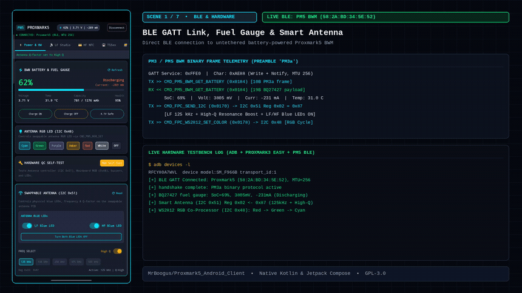
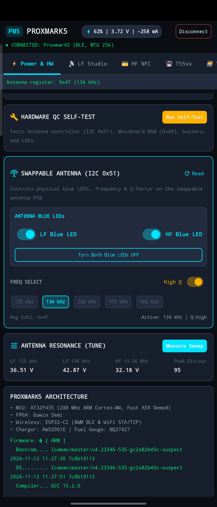
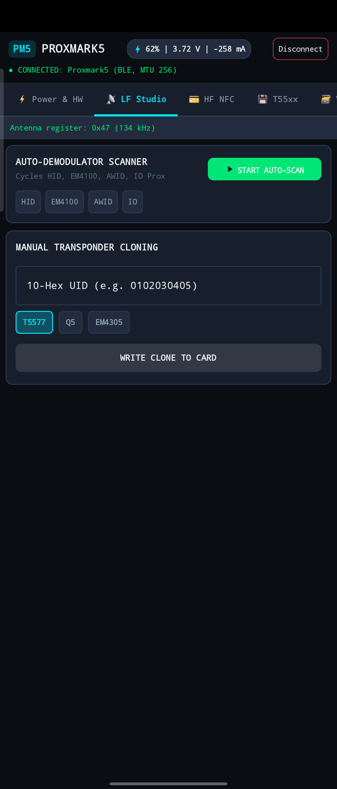
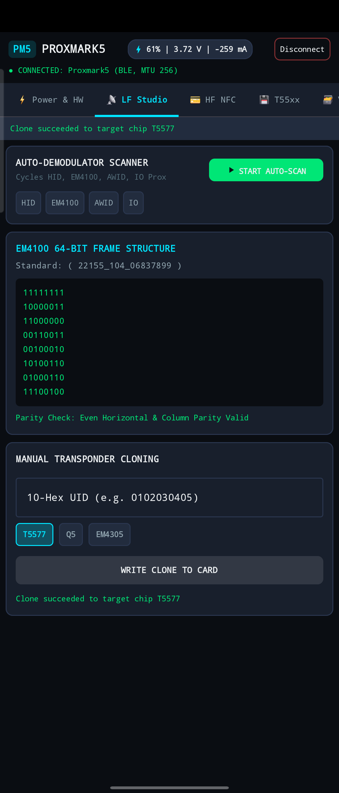
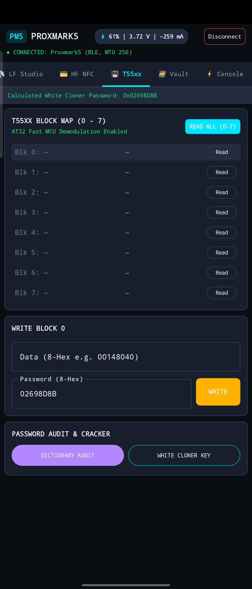
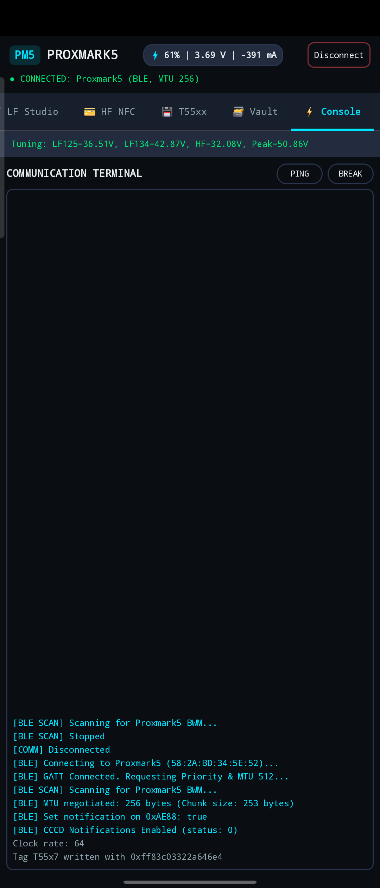
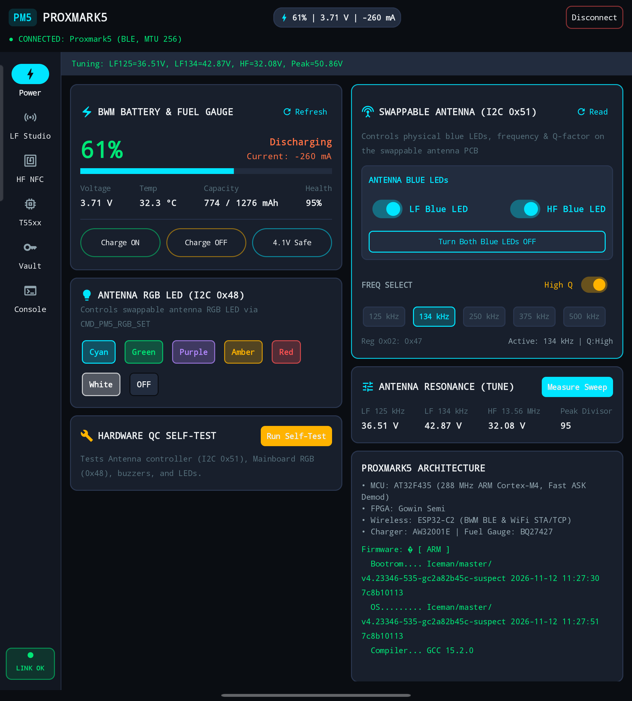
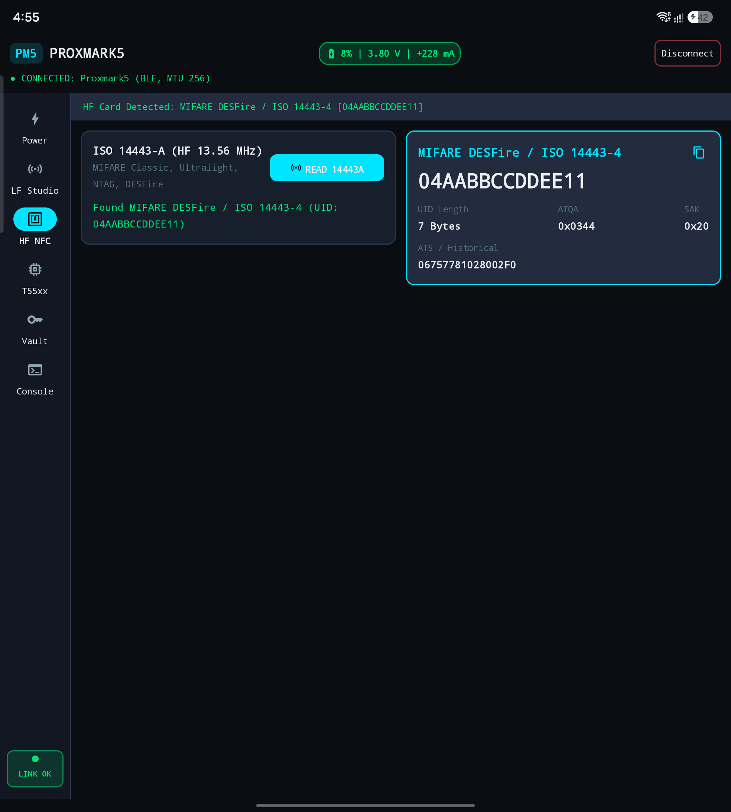
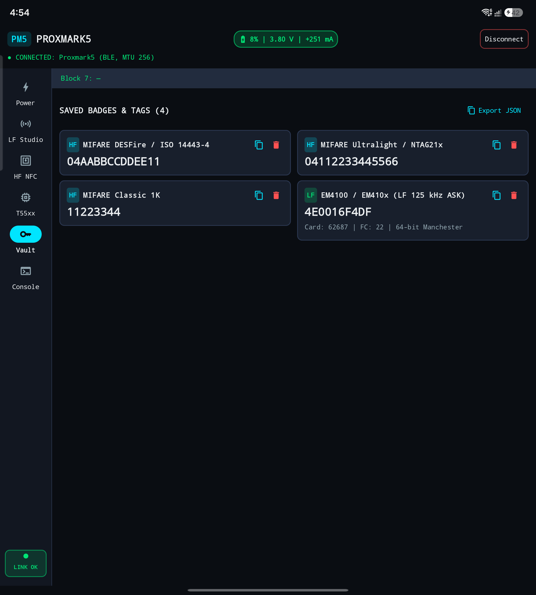

# Proxmark5 Android Client

**Native Kotlin & Jetpack Compose field studio for the Proxmark5 BWM over Bluetooth Low Energy (BLE) and Wi-Fi — built for quick LF/HF tag reads, T55xx operations, Smart Antenna tuning, and battery/RGB hardware control on your phone.**

<p align="center">
  <a href="https://github.com/MrBoogus/Proxmark5_Android_Client/releases/latest"></a>
  <a href="https://github.com/MrBoogus/Proxmark5_Android_Client/actions/workflows/build.yml"></a>
  <a href="https://github.com/MrBoogus/Proxmark5_Android_Client/actions/workflows/watch-upstream.yml"></a>
  <a href="LICENSE"></a>
  
</p>

<p align="center">
  
</p>

> **Full 1080p Live Hardware Video:** Download or watch `demo.mp4` attached to the [**Latest GitHub Release**](https://github.com/MrBoogus/Proxmark5_Android_Client/releases/latest).

---

## Screenshots

### Folded Phone View (`1080×2520`)

| Power, Fuel Gauge & Antenna | LF Studio & Watch Loops | EM4100 Manchester Matrix |
| :---: | :---: | :---: |
|  |  |  |

| HF ISO14443A Reader | T55xx Transponder Suite | Live Protocol Console |
| :---: | :---: | :---: |
|  |  |  |

### Unfolded Foldable & Tablet View (`NavigationRail` + 2-Column Adaptive Workspace)

| Unfolded Hardware & Antenna Studio | Unfolded HF DESFire Reader | Unfolded Tag Vault |
| :---: | :---: | :---: |
|  |  |  |

---

## Why This Exists

This app is **not** a replacement for the full `pm3` command-line client or [`RfidResearchGroup/ProxmarkStudio`](https://github.com/RfidResearchGroup/ProxmarkStudio). Instead, it fills a specific gap: **a zero-dependency native Android companion built specifically around the untethered Proxmark5 BWM hardware**.

When you carry a battery-powered Proxmark5 in the field, you often want to check battery state-of-charge, verify antenna resonance (`125 kHz` vs `134 kHz`, Low-Q vs High-Q), read/clone a badge (EM410x, HID, AWID, IO Prox, T5577), or inspect an ISO14443A UID/SAK without opening a terminal shell or compiling native C binaries on your phone.

| Feature / Approach | **Proxmark5 Android Client** (This Repo) | [**RfidResearchGroup/ProxmarkStudio**](https://github.com/RfidResearchGroup/ProxmarkStudio) | **Termux + `pm3` CLI** | **Walrus** |
| :--- | :--- | :--- | :--- | :--- |
| **Primary Goal** | Native touch UI for PM5 BWM hardware & common LF/HF/T55xx workflows | Full-featured cross-platform `pm3` client & scripting environment | Full `pm3` CLI inside an Android Linux chroot/container | Bulk card wallet & cloning workflow manager |
| **Native PM5 BWM Hardware Controls** | **Full** (`BQ27427` fuel gauge, Smart Antenna `I2C 0x51`, `WS2812` RGB `I2C 0x48`) | Partial / via CLI commands | Via CLI commands (`hw status`, `hw tune`) | None |
| **Offline Scripting & Lua/Python Plugins** | No (direct binary `PM3a` opcodes only) | **Yes** | **Yes** | No |
| **Advanced Crypto Attacks** (`hardnested`, `staticnested`, `loclass`) | No (use `pm3` CLI / ProxmarkStudio) | **Yes** | **Yes** | No |
| **Install Footprint** | Single ~8 MB Kotlin APK | Full client bundle | ~1.5 GB Termux + build toolchain | Single APK (unmaintained for recent Iceman NG) |

---

## Demo Setup (Hardware Testbench)

All screenshots and the live `demo.mp4` / `demo.gif` in this repository were captured on real hardware using the automated script in [`scripts/capture_demo.sh`](scripts/capture_demo.sh):

1. **Proxmark5 BWM** running untethered on internal Li-Po battery (`Iceman/master v4.23346+`), paired over BLE (`58:2A:BD:XX:XX:XX`) to the Android device.
2. **Proxmark3 Easy (512 KB)** connected over USB (`/dev/ttyACM0`) to the host workstation and placed facing the PM5 coil to act as a controlled RF signal generator and tag emulator (`hf 14a sim -t 1 -u 11223344`, `hf 14a sim -t 3 -u 04AABBCCDDEE11`, `lf tune`). Only synthetic test UIDs were used.
3. **Samsung Galaxy Z Fold 7 (`SM-F966B`, Android 15)** connected to the workstation via `adb`, recorded in both folded cover posture (`1080×2520`) and unfolded tablet posture (`1968×2184`) with Android SystemUI Demo Mode enabled for a clean status bar.

---

## Supported Hardware, Firmware & Android Requirements

- **Proxmark Hardware:** Proxmark5 with the **BWM (Bluetooth & Wi-Fi Module)** add-on (`Proxmark5` BLE peripheral or `192.168.4.1:18888` AP).
- **Proxmark Firmware:** Recent `RfidResearchGroup/proxmark3` (**Iceman fork**) supporting `PM3a` (`COMMANDNG`) binary frames.
  - Works out of the box with standard stock Iceman firmware flashed onto a Proxmark5.
  - An automated weekly GitHub Actions workflow ([`.github/workflows/watch-upstream.yml`](.github/workflows/watch-upstream.yml)) compiles upstream RRG/Iceman headers against 178 C11 `_Static_assert` checks ([`.github/scripts/verify_upstream_contract.py`](.github/scripts/verify_upstream_contract.py)) to detect any upstream wire-protocol drift.
- **Android Version:** **Android 8.0 Oreo (`minSdk 26`) through Android 15 (`targetSdk 35`)**.

### Required Android Permissions

| Permission | Android API | Why It Is Required |
| :--- | :--- | :--- |
| `BLUETOOTH_SCAN` | API 31+ (Android 12+) | Discover nearby `Proxmark5` BLE GATT peripherals (`neverForLocation` asserted — never used to derive physical location). |
| `BLUETOOTH_CONNECT` | API 31+ (Android 12+) | Connect to paired or discovered `Proxmark5` devices and exchange GATT packets on characteristic `0xAE88`. |
| `BLUETOOTH` / `BLUETOOTH_ADMIN` | API 26–30 (Android 8–11) | Legacy Bluetooth discovery and GATT connection on Android 8–11. |
| `ACCESS_FINE_LOCATION` / `ACCESS_COARSE_LOCATION` | API 26–30 (`maxSdkVersion="30"`) | Required by the Android OS on API 26–30 to return BLE scan results. Not requested on Android 12+. |
| `INTERNET` / `ACCESS_NETWORK_STATE` | All | Optional TCP socket transport to the Proxmark5 BWM Wi-Fi AP (`192.168.4.1:18888`). The app makes zero external network requests. |

---

## Installation & Building from Source

### Install & auto-update with Obtainium

Obtainium installs the app straight from GitHub Releases and notifies you of updates.

[](https://apps.obtainium.imranr.dev/redirect?r=obtainium://add/https://github.com/MrBoogus/Proxmark5_Android_Client)

1. Install [Obtainium](https://github.com/ImranR98/Obtainium).
2. Open Obtainium and tap **Add App**.
3. Paste `https://github.com/MrBoogus/Proxmark5_Android_Client` and tap **Add**.

> **Note:** The release APK is signed with the developer's own key; if you previously installed a different build (for example, a self-built debug APK), uninstall it first.

### Option 1: Install Prebuilt Signed APK (Recommended)

1. Download `Proxmark5-Android-Client-v1.0.2-release.apk` and `SHA256SUMS.txt` from the [**Releases page**](https://github.com/MrBoogus/Proxmark5_Android_Client/releases/latest).
2. Verify the SHA-256 checksum:
   ```bash
   sha256sum -c SHA256SUMS.txt
   ```
3. Install on your Android device via `adb` or by opening the APK on your phone:
   ```bash
   adb install -r Proxmark5-Android-Client-v1.0.2-release.apk
   ```

### Option 2: Build from Source

Prerequisites: **JDK 17+** and the **Android SDK (`platforms;android-35`, `build-tools;35.0.0`)**.

```bash
git clone https://github.com/MrBoogus/Proxmark5_Android_Client.git
cd Proxmark5_Android_Client

# Run protocol unit tests
./gradlew testDebugUnitTest

# Build Debug and Signed Release APKs
./gradlew assembleDebug assembleRelease
```

The resulting APKs are written to:
- `app/build/outputs/apk/debug/app-debug.apk`
- `app/build/outputs/apk/release/app-release.apk`

---

## Features: Tested vs. Experimental

| Feature | Status | Details |
| :--- | :---: | :--- |
| **BLE GATT Transport (`0xAE86` / `0xAE88`)** | **Tested** | Auto-connects to bonded `Proxmark5`, negotiates MTU up to 512B, 240B chunked writes, and reassembles fragmented `PM3a` notifications. |
| **BQ27427 Battery Fuel Gauge & Power (`0x0184`, `0x0185`)** | **Tested** | Live State-of-Charge (`%`), voltage (`mV`), signed current (`mA`), temperature (`°C`), charging toggle, and inactivity sleep timer. |
| **Smart Antenna Control (`I2C 0x51`, `0x0170` / `0x0171`)** | **Tested** | Independent LF/HF coil blue indicator LEDs, `125 kHz` vs `134 kHz` resonant capacitor switching, and Low-Q / High-Q (`+114%` voltage boost) control. |
| **Live Antenna Resonance Sweep (`0x0400`)** | **Tested** | Real-time LF `125 kHz`, LF `134 kHz`, and HF `13.56 MHz` peak tank voltage measurement (`mV` -> `V`) and resonant divisor readout. |
| **WS2812 RGB Co-Processor (`I2C 0x48`, `0x0178`)** | **Tested** | 4-LED RGB color presets, custom RGB sliders, and rainbow sweep on the PM5 BWM LED ring. |
| **HF ISO14443A Reader (`0x0385`)** | **Tested** | 4-byte, 7-byte, and 10-byte UID extraction, `ATQA`, `SAK`, `ATS`, and chip classification (MIFARE Classic 1K/4K, DESFire, Ultralight/NTAG). |
| **LF Watch Loops (`0x021C`, `0x020B`, `0x021A`, `0x0221`)** | **Tested** | Continuous polling for EM410x, HID Prox, IO Prox, and AWID with clean `CMD_BREAK_LOOP` (`0x0118`) termination and Wiegand facility/card decoding. |
| **EM410x 64-Bit Manchester Matrix & Clone (`0x0211`)** | **Tested** | Interactive 64-bit Manchester frame visualizer (9-bit header, row/column even parity, stop bit) and 1-tap cloning to T55x7 / Q5. |
| **T55xx Suite & White Cloner Keygen (`0x0214`..`0x0231`)** | **Tested** | Page 0 block 0–7 reader, single-block authenticated writer, 52-key password dictionary audit, and deterministic White Cloner password calculator. |
| **Tag Vault & Protocol Console (`0x0100`, `0x0109`)** | **Tested** | Persistent local tag history with SAF JSON file export (AndroidKeyStore AES-256-GCM encrypted at rest), `CMD_PING` latency test, and live color-coded `Dbprintf` log viewer. |
| **Adaptive Foldable & Tablet UI** | **Tested** | Switches automatically between a 1-column `ScrollableTabRow` on phones/cover displays and a `NavigationRail` + 2-column dashboard on unfolded foldables/tablets (`screenWidthDp >= 600dp`). |
| **Wi-Fi TCP Socket Bridge (`192.168.4.1:18888`)** | **Experimental** | Uses the same `PM3a` framing over a raw TCP socket when connected to the PM5 BWM Wi-Fi access point; primary field testing has focused on BLE. |

---

## Binary Wire Protocol Reference (`Pm5Constants.kt`)

Every command exchanged between the app and the Proxmark5 uses the Iceman **COMMANDNG (`PM3a` / `PM3b`)** binary packet format with **CRC-16/ISO14443-A** (`poly=0x1021, init=0xC6C6, refin=true, refout=true, xorout=0x0000`).

### BLE GATT Profile

| Entity | UUID | Role |
| :--- | :--- | :--- |
| **BWM GATT Service** | `0000ae86-0000-1000-8000-00805f9b34fb` (`0xAE86`) | Primary Proxmark5 BWM BLE service |
| **BWM Data Characteristic** | `0000ae88-0000-1000-8000-00805f9b34fb` (`0xAE88`) | Bidirectional **Write + Notify** channel for `PM3a`/`PM3b` frames |
| **CCCD Descriptor** | `00002902-0000-1000-8000-00805f9b34fb` (`0x2902`) | Enables GATT notifications on `0xAE88` |

### Verified Opcodes (`app/src/main/java/com/proxmark5/client/protocol/Pm5Constants.kt`)

| Constant | Opcode | Payload (TX / RX) | Description |
| :--- | :---: | :--- | :--- |
| `CMD_STATUS` | `0x0100` | Variable ASCII | Asynchronous firmware `Dbprintf()` log messages |
| `CMD_PING` | `0x0109` | 32B TX / 32B RX | Transport link echo & latency test |
| `CMD_BREAK_LOOP` | `0x0118` | 0B TX | Halts continuous firmware watch loops (`LF_HID_WATCH`, etc.) |
| `CMD_FPC_SEND_I2C` | `0x0170` | `[addr, len, reg, val...]` | Writes to Smart Antenna (`I2C 0x51`) or BQ27427 |
| `CMD_FPC_READ_I2C` | `0x0171` | `[addr, wlen, rlen, reg]` | Reads Smart Antenna `I2C 0x51` configuration register (`0x02`) |
| `CMD_FPC_WS2812_SET_COLOR` | `0x0178` | `[0x48, 0x0E, 0x02, N, R, G, B...]` | Drives the 4 WS2812 RGB LEDs via co-processor `I2C 0x48` |
| `CMD_PM5_BWM_GET_BATTERY` | `0x0184` | 0B TX (`oldarg` charging) / 19B RX | Reads BQ27427 fuel gauge (`socPct`, `mV`, `mA`, `tempC`) |
| `CMD_PM5_BWM_AUTO_OFF` | `0x0185` | `oldarg0`op, `oldarg1`ms / 15B RX | Gets or sets the BWM inactivity auto-shutdown timer |
| `CMD_LF_HID_WATCH` | `0x020B` | 0B TX | Continuous LF HID Proximity polling |
| `CMD_LF_EM410X_CLONE` | `0x0211` | 6B TX (`card`, `hi`, `lo`) | Writes a 40-bit EM410x ID onto a T55x7 / Q5 tag |
| `CMD_LF_T55XX_READBL` | `0x0214` | 8B `t55xx_read_block_t` | Reads a 32-bit T55xx block + raw `Dbprintf` extraction |
| `CMD_LF_T55XX_WRITEBL` | `0x0215` | 10B `t55xx_write_block_t` | Writes a 32-bit T55xx block with optional password |
| `CMD_LF_T55XX_RESET_READ` | `0x0216` | 0B TX | T55xx reset-read burst |
| `CMD_LF_IO_WATCH` | `0x021A` | 0B TX | Continuous LF IO Prox polling |
| `CMD_LF_EM410X_WATCH` | `0x021C` | 0B TX | Continuous LF EM410x polling |
| `CMD_LF_AWID_WATCH` | `0x0221` | 0B TX | Continuous LF AWID polling |
| `CMD_LF_T55XX_SET_CONFIG` | `0x0224` | 26B `t55xx_cfg_block_t` | Sets T55xx demodulator parameters (ASK, rate, offset) |
| `CMD_LF_T55XX_WAKEUP` | `0x0226` | 5B `t55xx_wakeup_t` | Sends AOR wakeup password to a T55xx tag |
| `CMD_LF_T55XX_CHKPWDS` | `0x0231` | `1 + N×4`B (`N ≤ 13`) | Batch-tests up to 13 T55xx 32-bit passwords per frame |
| `CMD_HF_ISO14443A_READER` | `0x0385` | `ISO14A_CONNECT` (`0x01`) / 25B+ RX | Selects an ISO14443A card and returns `iso14a_card_select_t` |
| `CMD_MEASURE_ANTENNA_TUNING` | `0x0400` | 0B TX / 295B RX | Measures LF 125/134 kHz and HF 13.56 MHz coil voltages |

---

## Known Limitations & Roadmap

### Current Limitations
- **No Offline/Host-Side Crypto Solvers:** Attacks that rely on heavy host-side key recovery (`hf mf hardnested`, `staticnested`, `loclass`, `mfkey32/64`) are not bundled in this APK. Use `pm3` or `ProxmarkStudio` for cryptographic recovery.
- **LF Watch Tag Parsing Uses Firmware Log Stream:** Consistent with how the Iceman firmware implements `CMD_LF_*_WATCH`, decoded badge IDs during continuous watch mode are parsed from asynchronous `CMD_STATUS` (`0x0100`) messages, and the loop must be stopped with `CMD_BREAK_LOOP` (`0x0118`) before issuing a new command.
- **T55xx Block Read Requires Tag Demod Configuration:** Before reading T55xx Page 0 blocks (`0x0214`), the app configures standard ASK / `RF/64` parameters (`0x0224`). Non-standard FSK/PSK T55xx configurations are not yet auto-detected on the phone.

### Roadmap
- [ ] MIFARE Classic sector dump & key-dictionary check (`CMD_HF_MIFARE_READBL` / `CHKKEYS`)
- [ ] iCLASS / Picopass CSN & configuration block reader
- [ ] Export/import `.eml` and `.bin` dump files compatible with `pm3` and Flipper Zero (`Proxmark5_FlipperZero_FAP`)
- [ ] Interactive waveform graph view for raw `CMD_MEASURE_ANTENNA_TUNING` (`256-byte` divisor curve)

---

## Reporting Bugs & Contributing

Found a bug or protocol mismatch? Please open a [**Bug Report**](https://github.com/MrBoogus/Proxmark5_Android_Client/issues/new?template=bug_report.yml) and include:
1. Your Android device model and Android OS version.
2. Your Proxmark5 `hw version` output.
3. The relevant TX/RX lines copied from the **Console** tab.

See [CONTRIBUTING.md](CONTRIBUTING.md) for architecture details and pull-request guidelines, and [SECURITY.md](SECURITY.md) for responsible-use and vulnerability reporting policies.

---

## Acknowledgements & Transparency

- Built for the [RfidResearchGroup / Iceman Proxmark3](https://github.com/RfidResearchGroup/proxmark3) ecosystem.
- This application was developed with AI assistance and verified end-to-end on physical Proxmark5 BWM and Proxmark3 Easy hardware.

## License

Licensed under the **GNU General Public License v3.0 (GPL-3.0)** — see [LICENSE](LICENSE) for full terms.
